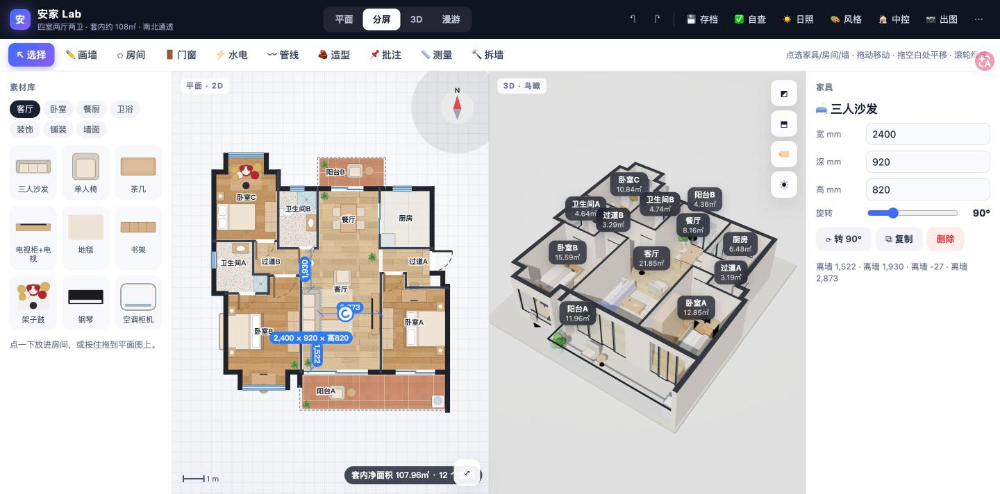
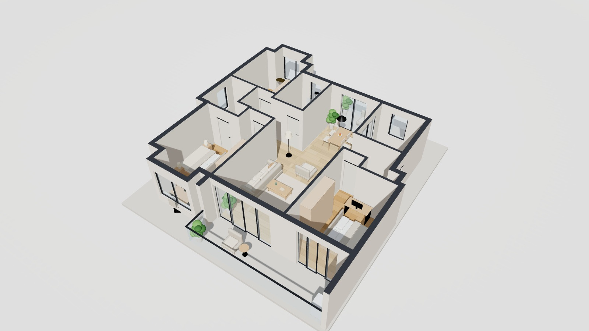
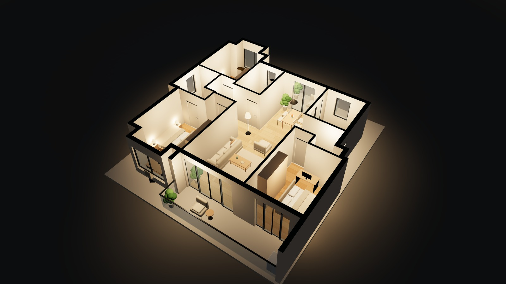
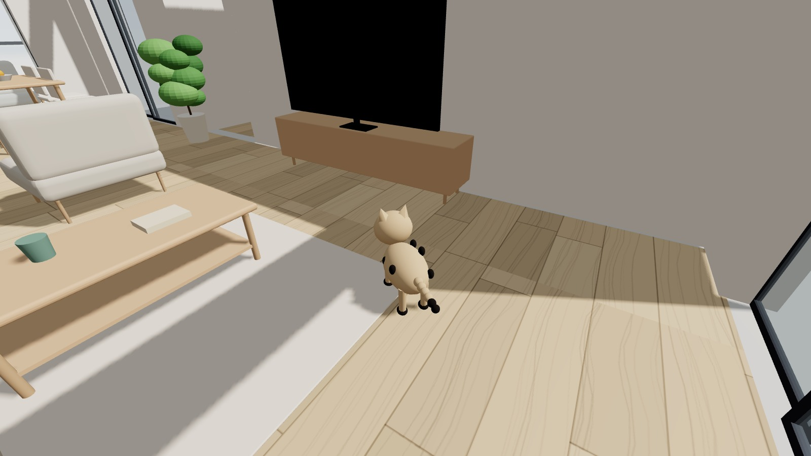
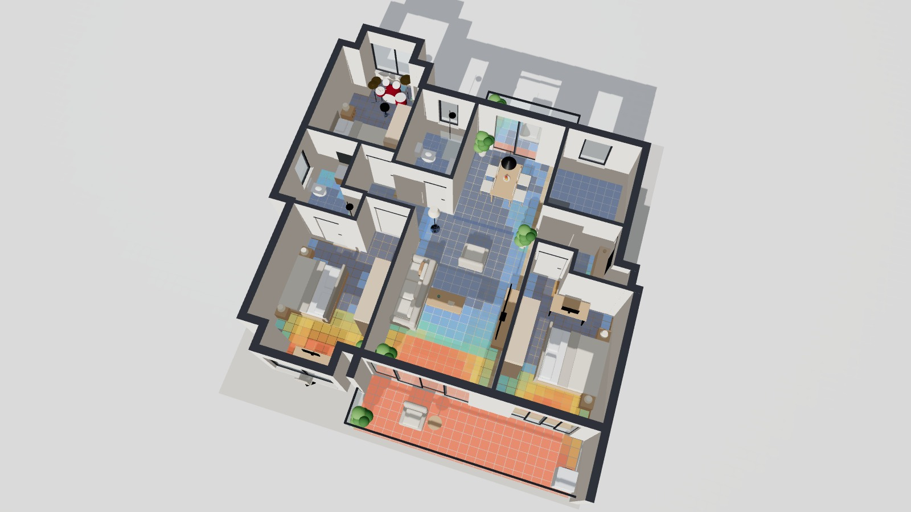
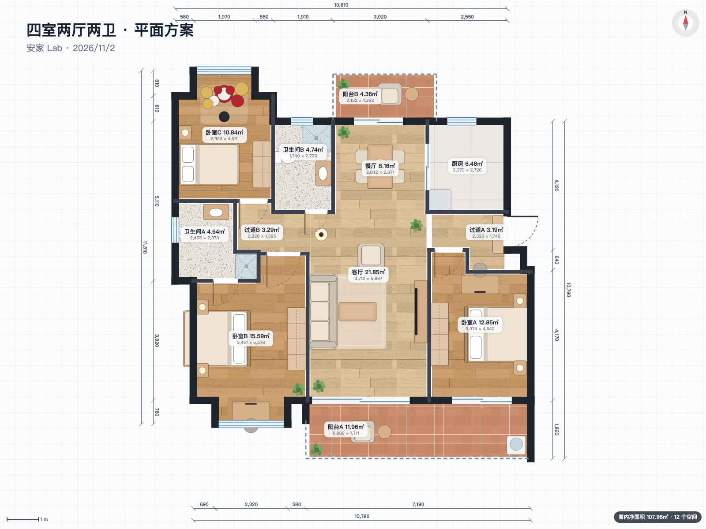
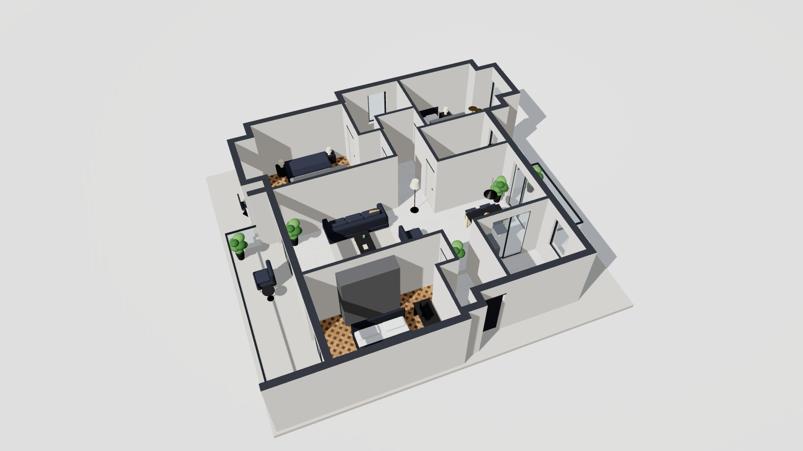

# 安家 Lab · 一张户型图 → 一个能逛的家

**[▶ 在线打开](https://waynearlyda-code.github.io/anjia-lab/)**　手机、电脑都能用，单个 HTML 文件，离线也能跑。



| | |
|:---:|:---:|
|  |  |
| 白天鸟瞰：开场时墙体从地里升起 | 夜景：每个房间亮起暖光 |
|  |  |
| 漫游：一只小黑足猫，能跳上沙发和床 | 冬至日照分析：每个房间晒几个小时 |
|  |  |
| 彩色平面图导出 | 一键换风格（图为轻奢） |

一个单文件、完全离线的 3D 户型装修设计器。户型数据从一张中介户型图逐像素扫描墙体得到，再用图上的房间面积逐个校准。

**在线打开**：GitHub Pages（`docs/index.html`）· **离线**：把 `docs/index.html` 下载下来双击就能用，所有代码和材质都在这一个文件里，手机电脑都行，不需要联网。

## 能做什么

- **2D 平面编辑**：选择、画墙、划房间、门窗、水电、管线、墙面造型、批注、测量、拆墙，撤销重做
- **素材库**：29 种家具（含架子鼓、猫爬架）、19 种程序生成的地面/墙面材质
- **3D 鸟瞰**：开场墙体从地里升起；点门能开关；选中家具可以在 3D 里直接拖
- **分屏联动**：左边拖家具，右边 3D 同步
- **日照模拟**：12 个城市、任意日期时间，太阳方位/高度/日出日落，日出→日落演示，平面光斑
- **冬至日照分析**：按窗洞和墙体追踪阳光，算出每个房间冬至日 8–16 点的直射时长，热力图贴在地面上
- **漫游**：变成一只小黑足猫（或小人）在屋里走，能跳上沙发和床，靠近门开门；手机上是虚拟摇杆
- **720° 全景**：站在房间中间环顾，手机支持体感；可导出等距柱状全景图
- **出图**：2560×1440 效果图、彩色平面图
- **一键风格**：奶油风 / 原木 / 现代极简 / 轻奢 / 新中式 / 侘寂
- **智能中控**：每个房间的灯、电视、所有门，回家/观影/睡眠/清晨场景
- **自查报告**：悬空墙、门窗越界、12 个房间面积和图纸标注逐一对比
- **方案存档**：自动保存；另有 6 个手动存档位，带缩略图，随时读回对比；可导出/导入 JSON；撤销/重做（手机也有）

## 结构

```
src/data.js        户型数据（墙、门窗、房间、默认家具）
src/geom.js        几何工具 + 太阳位置算法
src/textures.js    程序生成材质
src/furniture.js   家具 2D 俯视图 + 3D 模型
src/analysis.js    日照射线追踪 + 水电自动布置
src/view3d.js      3D 场景、相机、灯光、漫游、全景、出图
src/plan2d.js      2D 编辑器
src/main.js        界面和状态
build.sh           打包成单个 HTML（Three.js r160 内联）
```

改完源码跑 `./build.sh`，生成 `docs/index.html`。

Three.js 使用 MIT 许可。
